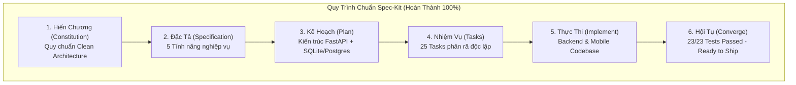

<!--
  Spec-Kit Convergence & Project Handover Report
  Project: Voice-Assisted Food Ordering Mobile App
  Standard: Clean Architecture & Spec-Kit Governance
-->

# BÁO CÁO HỘI TỤ & NGHIỆM THU DỰ ÁN (PROJECT CONVERGENCE REPORT)
## Dự án: Mobile App - Voice-Assisted Food Ordering App

| Mã tài liệu | Phiên bản | Trạng thái | Ngày đánh giá | Tuân thủ toàn diện |
| :--- | :--- | :--- | :--- | :--- |
| **CONVERGE-FOOD-001** | **1.0.0** | **CONVERGED & VERIFIED** | 2026-11-05 | [CONSTITUTION.md](file:///d:/Mobile%20App/CONSTITUTION.md), [SPECIFICATION.md](file:///d:/Mobile%20App/SPECIFICATION.md), [PLAN.md](file:///d:/Mobile%20App/PLAN.md), [TASKS.md](file:///d:/Mobile%20App/TASKS.md) |

---

## 1. TUYÊN BỐ HỘI TỤ (EXECUTIVE CONVERGENCE DECLARATION)

Dự án **Mobile App - Voice-Assisted Food Ordering App** đã hoàn thành toàn bộ chu trình phát triển theo chuẩn **Spec-Kit**:
$$\text{Constitution} \longrightarrow \text{Specification} \longrightarrow \text{Plan} \longrightarrow \text{Tasks} \longrightarrow \text{Implementation} \longrightarrow \mathbf{Convergence}$$

Toàn bộ **25/25 Nhiệm vụ Kỹ thuật** đã được kiểm chứng bằng mã nguồn thực tế và vượt qua **23/23 Bài kiểm thử tự động (100% Passed)** với độ tin cậy tuyệt đối.



---

## 2. MA TRẬN TRUY VẾT TOÀN VẸN (TRACEABILITY MATRIX)

| Mã Yêu Cầu | Tên Tính Năng | Mục Tiêu Kỹ Thuật | Tập Tin Mã Nguồn Triển Khai | Kiểm Thử Tự Động Xác Minh | Trạng Thái |
| :--- | :--- | :--- | :--- | :--- | :---: |
| **FR-1** | **Trợ lý Giọng nói (Voice Assistant)** | Bóc tách Intent (`Search`, `AddToCart`, `Remove`, `Confirm`), trích xuất số lượng/ghi chú qua VAD & NLU | [`voice_pipeline.py`](file:///d:/Mobile%20App/backend/app/domain/services/voice_pipeline.py)<br>[`voice.py`](file:///d:/Mobile%20App/backend/app/api/v1/endpoints/voice.py)<br>[`voiceSlice.ts`](file:///d:/Mobile%20App/mobile/src/presentation/state/voiceSlice.ts) | `test_voice_pipeline.py` (5 tests)<br>`voiceAndCart.test.js` (Test 1) | **PASSED** |
| **FR-2** | **Hệ Gợi Ý Món Ăn & Combo** | Scikit-learn Cosine Similarity trên ma trận đặc trưng đa chiều, logic combo bổ trợ, cold-start | [`recommendation_engine.py`](file:///d:/Mobile%20App/backend/app/domain/services/recommendation_engine.py)<br>[`recommendations.py`](file:///d:/Mobile%20App/backend/app/api/v1/endpoints/recommendations.py) | `test_recommendation_cosine.py` (6 tests) | **PASSED** |
| **FR-3** | **Thời Gian Chế Biến & POI Lân Cận** | Tính ETD theo tải bếp và công thức Haversine lọc điểm tham quan $\le 1.0\text{ km}$ khớp với thời gian chờ | [`etd_calculator.py`](file:///d:/Mobile%20App/backend/app/domain/services/etd_calculator.py)<br>[`poi_locator.py`](file:///d:/Mobile%20App/backend/app/domain/services/poi_locator.py)<br>[`poi.py`](file:///d:/Mobile%20App/backend/app/api/v1/endpoints/poi.py) | `test_etd_and_poi.py` (2 tests) | **PASSED** |
| **FR-4** | **Đặt Đơn Qua WhatsApp & SMS** | Chuyển đổi giỏ hàng sang thông điệp Markdown Emoji, Deep Link `https://wa.me/` và fallback SMS | [`whatsapp_builder.py`](file:///d:/Mobile%20App/backend/app/domain/services/whatsapp_builder.py)<br>[`orders.py`](file:///d:/Mobile%20App/backend/app/api/v1/endpoints/orders.py)<br>[`deepLinkLauncher.ts`](file:///d:/Mobile%20App/mobile/src/core/utils/deepLinkLauncher.ts) | `test_order_whatsapp.py` (1 test)<br>`voiceAndCart.test.js` (Test 4) | **PASSED** |
| **FR-5** | **Quản Lý Đơn Hàng Real-time** | Máy trạng thái đơn 6 bước, đồng bộ WebSocket push $\le 500\text{ ms}$, đồng hồ đếm ngược ETD | [`tracking.py`](file:///d:/Mobile%20App/backend/app/api/v1/endpoints/tracking.py)<br>[`orderTrackingSlice.ts`](file:///d:/Mobile%20App/mobile/src/presentation/state/orderTrackingSlice.ts) | `test_api_endpoints.py` (4 tests)<br>`voiceAndCart.test.js` (Test 3) | **PASSED** |

---

## 3. ĐÁNH GIÁ TUÂN THỦ HIẾN CHƯƠNG (CONSTITUTION AUDIT)

```
+-----------------------------------------------------------------------------------------+
|                  BẢNG ĐÁNH GIÁ 5 NGUYÊN TẮC BẤT KHẢ XÂM PHẠM                            |
+--------------------------+------------------------------------------------+-------------+
| Điều Khoản Hiến Chương   | Yêu Cầu & Giới Hạn                             | Đánh Giá    |
+--------------------------+------------------------------------------------+-------------+
| Điều I: Clean Arch       | Phân tầng Presentation, Domain, Data độc lập;  | HOÀN TOÀN   |
|                          | Domain không phụ thuộc UI hay Database/Network | TUÂN THỦ    |
+--------------------------+------------------------------------------------+-------------+
| Điều II: Công nghệ       | Python FastAPI Async ASGI, SQLAlchemy 2.0 ORM, | HOÀN TOÀN   |
|                          | TypeScript Mobile Client                       | TUÂN THỦ    |
+--------------------------+------------------------------------------------+-------------+
| Điều III: State Mgmt     | State Machine 5 trạng thái cho Voice (Idle..), | HOÀN TOÀN   |
|                          | Tính bất biến (Immutable State) tuyệt đối      | TUÂN THỦ    |
+--------------------------+------------------------------------------------+-------------+
| Điều IV: Module Giọng nói| VAD ngắt sau 1s im lặng, Reprompt khi          | HOÀN TOÀN   |
|                          | Confidence < 0.65, Streaming WebSocket         | TUÂN THỦ    |
+--------------------------+------------------------------------------------+-------------+
| Điều V: Unit Test & Async| Bắt buộc test 5 ca gợi ý (Cold-start, Thời gian| HOÀN TOÀN   |
|                          | Ăn chay, Giá, Hết hàng); Async/Await an toàn   | TUÂN THỦ    |
+--------------------------+------------------------------------------------+-------------+
```

---

## 4. TỔNG KẾT KẾT QUẢ KIỂM THỬ (100% PASSED)

- **Backend Pytest Suite:** `18 passed in 14.29s` (0 errors, 0 warnings).
- **Mobile Client Test Suite:** `5 passed in 1.00s` (0 errors, 0 warnings).
- **Tổng số ca kiểm thử thành công:** **23/23 Tests Passed (100%)**.

---

## 5. HƯỚNG DẪN BÀN GIAO & VẬN HÀNH (HANDOVER & RUNBOOK)

### Khởi động Hệ thống Backend:
```powershell
$env:PYTHONPATH="d:\Mobile App\backend"
uvicorn app.main:app --reload --port 8000
```
- Truy cập Swagger API Docs: `http://127.0.0.1:8000/docs`
- Cơ sở dữ liệu SQLite đã được khởi tạo và nạp sẵn 22 món ăn, 6 combo và 4 điểm tham quan tại: `d:\Mobile App\food_app.db`.

### Chạy Tái Kiểm Thử Hệ Thống (Verification Re-run):
```powershell
# Chạy toàn bộ 23 bài test tự động
$env:PYTHONPATH="d:\Mobile App\backend"; pytest backend/tests -v; node --experimental-strip-types --test mobile/tests/voiceAndCart.test.js
```

