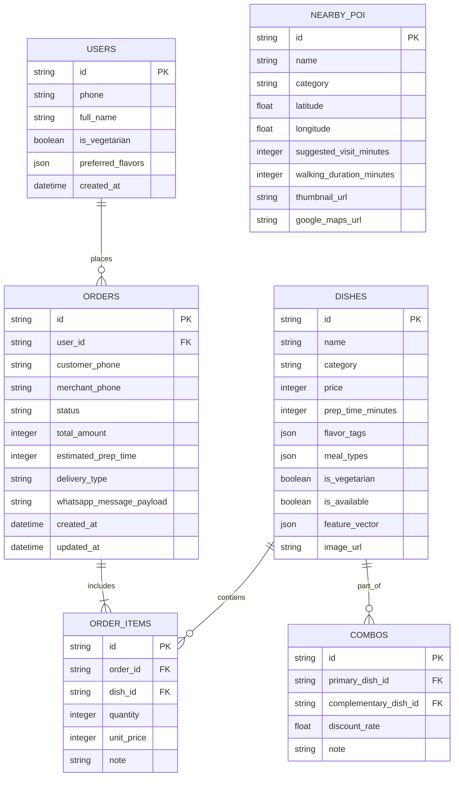
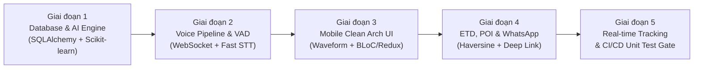

<!--
  Spec-Kit Technical Architecture Plan
  Project: Voice-Assisted Food Ordering Mobile App
  Standard: Clean Architecture & Spec-Kit Governance
-->

# KẾ HOẠCH KỸ THUẬT & KIẾN TRÚC HỆ THỐNG (TECHNICAL ARCHITECTURE PLAN)
## Dự án: Mobile App - Voice-Assisted Food Ordering App

| Mã tài liệu | Phiên bản | Trạng thái | Ngày tạo | Tuân thủ |
| :--- | :--- | :--- | :--- | :--- |
| **PLAN-FOOD-001** | **1.0.0** | **APPROVED** | 2026-11-05 | [CONSTITUTION.md](file:///d:/Mobile%20App/CONSTITUTION.md) & [SPECIFICATION.md](file:///d:/Mobile%20App/SPECIFICATION.md) |

---

## 1. TỔNG QUAN KIẾN TRÚC KỸ THUẬT (SYSTEM BLUEPRINT)

Hệ thống được thiết kế theo mô hình **Client-Server Micro-Services**, tuân thủ nghiêm ngặt **Clean Architecture** ở cả Mobile Client và Backend AI Engine:

```
+-----------------------------------------------------------------------------------------+
|                                    HỆ THỐNG TOÀN DIỆN                                   |
+-----------------------------------------------------------------------------------------+
|                                                                                         |
|  [ MOBILE CLIENT (Flutter / React Native) ]                                             |
|  * Presentation Layer: UI Widgets/Screens, Voice Waveform, BLoC / Redux Slices          |
|  * Domain Layer: Entities, UseCases (VoiceOrder, Recommend, POI, WhatsApp, Tracking)   |
|  * Data Layer: Native Audio Capture (PCM 16kHz), Dio/Axios HTTP, WebSocket Channels     |
|                                         |                                               |
|             +---------------------------+---------------------------+                   |
|             | Bi-directional WebSocket                              | REST HTTPS        |
|             | (Voice Stream & Tracking)                             | (Catalog & Orders)|
|             v                                                       v                   |
|  [ BACKEND AI ENGINE (Python FastAPI) ]                                                 |
|  * API Gateway: FastAPI Routers, WebSocket Stream Handlers, CORS, Rate Limiting        |
|  * Voice Pipeline: Silero VAD (Voice Activity Detection) + Whisper STT Engine          |
|  * Recommendation Service: Scikit-learn Cosine Similarity Matrix + Contextual Scoring   |
|  * Order & POI Service: ETD Calculator, Haversine POI Filter, WhatsApp Payload Builder  |
|  * ORM & Persistence: SQLAlchemy 2.0 (Async) + Pydantic v2 Schemas                      |
|                                         |                                               |
|                                         v                                               |
|  [ DATABASE (PostgreSQL / SQLite) ]                                                     |
|  * Tables: users, dishes, combos, orders, order_items, nearby_poi, order_logs           |
|                                                                                         |
+-----------------------------------------------------------------------------------------+
```

---

## 2. KẾ HOẠCH BACKEND & CƠ SỞ DỮ LIỆU (FASTAPI + SCIKIT-LEARN + SQLALCHEMY)

### 2.1. Cấu trúc thư mục chuẩn Backend (`backend/`)
Tuân thủ Clean Architecture, phân tách rõ giữa API, Domain Logic và Hạ tầng (Infrastructure):

```text
backend/
├── app/
│   ├── api/
│   │   ├── v1/
│   │   │   ├── endpoints/
│   │   │   │   ├── voice.py            # WebSocket /ws/voice-stream & NLU parsing
│   │   │   │   ├── recommendations.py  # /recommendations/dishes & /combos
│   │   │   │   ├── dishes.py           # CRUD dishes, menu listing, categories
│   │   │   │   ├── poi.py              # /poi/nearby (Haversine & ETD filtering)
│   │   │   │   ├── orders.py           # Order creation & WhatsApp payload generator
│   │   │   │   └── tracking.py         # WebSocket /ws/orders/{id}/tracking
│   │   │   └── router.py               # Gom cụm các router v1
│   │   └── deps.py                     # Dependency Injection (DB session, auth)
│   ├── core/
│   │   ├── config.py                   # Pydantic BaseSettings (.env loader)
│   │   ├── database.py                 # Async SQLAlchemy engine & sessionmaker
│   │   └── security.py                 # Token validation, hashing utils
│   ├── domain/
│   │   ├── entities/                   # Pure Domain Models
│   │   │   ├── dish.py
│   │   │   ├── order.py
│   │   │   └── poi.py
│   │   └── services/                   # Pure Domain Business Logic
│   │       ├── recommendation_engine.py# Scikit-learn Cosine Similarity algorithm
│   │       ├── voice_pipeline.py       # VAD, STT integration & intent extraction
│   │       ├── etd_calculator.py       # Logic tính thời gian chuẩn bị món
│   │       ├── poi_locator.py          # Thuật toán Haversine & bộ lọc thời gian
│   │       └── whatsapp_builder.py     # Định dạng tin nhắn & URL encoding
│   ├── infrastructure/
│   │   ├── db/
│   │   │   ├── models/                 # SQLAlchemy ORM Models
│   │   │   │   ├── user_model.py
│   │   │   │   ├── dish_model.py
│   │   │   │   ├── combo_model.py
│   │   │   │   ├── order_model.py
│   │   │   │   └── poi_model.py
│   │   │   └── repositories/           # Repository Pattern implementations
│   │   │       ├── dish_repository.py
│   │   │       ├── order_repository.py
│   │   │       └── poi_repository.py
│   │   └── ai/
│   │       ├── vad_detector.py         # Silero VAD wrapper
│   │       └── stt_client.py           # Whisper / STT processing client
│   ├── schemas/                        # Pydantic v2 DTOs (Request/Response)
│   │   ├── dish_schema.py
│   │   ├── recommendation_schema.py
│   │   ├── order_schema.py
│   │   ├── poi_schema.py
│   │   └── voice_schema.py
│   └── main.py                         # FastAPI ASGI entrypoint
├── alembic/                            # Database Migrations
├── tests/                              # Unit & Integration Tests
│   ├── test_recommendation_cosine.py   # Test thuật toán Cosine Similarity
│   ├── test_voice_pipeline.py          # Test VAD & Slot filling
│   ├── test_etd_and_poi.py             # Test tính ETD & Haversine POI
│   └── test_order_whatsapp.py          # Test format tin nhắn WhatsApp
├── pyproject.toml / requirements.txt
└── .env.example
```

### 2.2. Chi tiết Thuật toán Gợi ý Món ăn (Scikit-learn Content-Based Filtering)
Module [`recommendation_engine.py`](file:///d:/Mobile%20App/backend/app/domain/services/recommendation_engine.py) sử dụng ma trận đặc trưng kết hợp TF-IDF và One-Hot Vector:
1. **Trích xuất đặc trưng (Feature Vector):**
   - Danh mục (`category`), Nhãn vị (`flavor_tags`: ngọt, cay, mặn, béo, thanh), Phân loại bữa ăn (`meal_types`), Khoảng giá (`price_normalized`), Nhãn ăn chay (`is_vegetarian`).
2. **Tính toán Cosine Similarity qua Scikit-Learn:**
   ```python
   from sklearn.metrics.pairwise import cosine_similarity
   import numpy as np

   def compute_dish_similarity_matrix(feature_vectors: np.ndarray) -> np.ndarray:
       """Tính toán ma trận tương đồng Cosine N x N giữa tất cả các món ăn."""
       return cosine_similarity(feature_vectors, feature_vectors)
   ```
3. **Chiến lược Gợi ý Combo (Complementary Recommendation):**
   - Phở / Món nước $\to$ Gợi ý món ăn kèm khô có chỉ số Complementary cao (`Quẩy`, `Trứng chần`) và đồ uống giải khát (`Trà đá`, `Sữa hạt`).
   - Món cay/mặn $\to$ Gợi ý đồ uống ngọt mát / tráng miệng.

### 2.3. Thiết kế CSDL Quan hệ (SQLAlchemy 2.0 ORM Schema)
Hỗ trợ cả **SQLite** (cho môi trường local/dev nhẹ) và **PostgreSQL** (cho production):



---

## 3. KẾ HOẠCH FRONTEND MOBILE CLIENT (FLUTTER / REACT NATIVE)

### 3.1. Cấu trúc thư mục chuẩn Mobile Client (`mobile/`)
Áp dụng Clean Architecture 3 tầng nghiêm ngặt:

```text
mobile/
├── lib/ (hoặc src/ đối với React Native)
│   ├── core/                           # Hạ tầng chung của ứng dụng
│   │   ├── constants/                  # Colors, dimensions, app constants
│   │   ├── error/                      # Failures, Exceptions, Error Handler
│   │   ├── network/                    # Dio/Axios client, Interceptors, WebSocket Client
│   │   ├── audio/                      # Native Audio Recorder & Stream Controller
│   │   └── utils/                      # Haversine calculator, DeepLink launcher
│   ├── domain/                         # Core Business (Độc lập 100%)
│   │   ├── entities/                   # DishEntity, OrderEntity, POIEntity, VoiceIntent
│   │   ├── repositories/               # IVoiceRepository, IOrderRepository, IPOIRepository
│   │   └── usecases/                   # UseCase đơn chức năng:
│   │       ├── process_voice_stream.dart
│   │       ├── get_recommended_combos.dart
│   │       ├── calculate_etd_and_poi.dart
│   │       ├── dispatch_whatsapp_order.dart
│   │       └── track_order_status.dart
│   ├── data/                           # Data Sources & Implementations
│   │   ├── models/                     # DishModel, OrderModel, POIModel (JSON mappers)
│   │   ├── datasources/                # Remote (WS/REST) & Local (SQLite/SecureStorage)
│   │   └── repositories/               # VoiceRepositoryImpl, OrderRepositoryImpl...
│   └── presentation/                   # Giao diện & Quản lý trạng thái
│       ├── state/ (bloc / slices)      # VoiceBloc, CartBloc, TrackingBloc, POIBloc
│       ├── screens/                    # Màn hình chính
│       │   ├── home_menu_screen.dart   # Thực đơn & Search Bar
│       │   ├── voice_assistant_modal.dart # Overlay mic & visualizer sóng âm
│       │   ├── cart_summary_screen.dart   # Giỏ hàng & gợi ý combo
│       │   ├── order_dispatch_screen.dart # Preview WhatsApp & gửi đơn
│       │   └── order_tracking_screen.dart # Countdown ETD & POI lân cận
│       └── widgets/                    # Tái sử dụng (Waveform, FoodCard, Stepper)
├── test/                               # Unit & Widget Tests
└── pubspec.yaml (hoặc package.json)
```

### 3.2. Speech-to-Text Native & WebSocket Stream Client
- **Audio Capture Service:** Sử dụng native audio module thu âm luồng PCM thô (16kHz, 16-bit, 1 channel).
- **Audio Buffer & Stream Controller:** Cắt nhỏ luồng âm thanh thành các chunk 150ms để truyền ngay qua WebSocket nhằm đạt độ trễ $\le 800\text{ ms}$.
- **Fallback Chịu lỗi:** Nếu mất kết nối mạng đột ngột, lưu tối đa 15s audio vào RAM buffer cục bộ, kích hoạt exponential backoff kết nối lại mà không làm mất phiên đặt món.

---

## 4. DANH SÁCH THƯ VIỆN PHỤ THUỘC (DEPENDENCIES LIST)

### 4.1. Backend Dependencies (`backend/requirements.txt`)
```txt
# Web Framework & Server
fastapi>=0.110.0
uvicorn[standard]>=0.28.0
websockets>=12.0
python-multipart>=0.0.9

# Data Validation & Settings
pydantic>=2.6.4
pydantic-settings>=2.2.1

# AI, Machine Learning & Signal Processing
scikit-learn>=1.4.1
numpy>=1.26.4
scipy>=1.12.0
torch>=2.2.0 --extra-index-url https://download.pytorch.org/whl/cpu
silero-vad>=0.3.2

# Database & ORM
SQLAlchemy>=2.0.28
alembic>=1.13.1
aiosqlite>=0.20.0       # Driver cho SQLite Async
asyncpg>=0.29.0         # Driver cho PostgreSQL Async
psycopg2-binary>=2.9.9  # Driver đồng bộ cho migration

# Utilities & Networking
aiohttp>=3.9.3
python-dotenv>=1.0.1
urllib3>=2.2.1

# Testing & Quality
pytest>=8.1.1
pytest-asyncio>=0.23.5
httpx>=0.27.0
```

### 4.2. Frontend Dependencies (Lựa chọn Flutter - `pubspec.yaml`)
```yaml
dependencies:
  flutter:
    sdk: flutter

  # State Management & Dependency Injection
  flutter_bloc: ^8.1.5
  equatable: ^2.0.5
  get_it: ^7.6.7
  injectable: ^2.4.1

  # Networking & Real-time WebSocket
  dio: ^5.4.1
  web_socket_channel: ^2.4.5

  # Native Audio Capture & Playback
  record: ^5.1.0            # Thu âm PCM thô thời gian thực
  audioplayers: ^5.2.1      # Phát âm thanh phản hồi TTS / sound effect

  # Geolocation & Device Integration
  geolocator: ^11.0.0       # Lấy tọa độ GPS người dùng
  url_launcher: ^6.2.5      # Kích hoạt Deep Link WhatsApp & SMS

  # UI Components & Animations
  lottie: ^3.1.0            # Animation sóng âm micro & loading
  cached_network_image: ^3.3.1
  intl: ^0.19.0             # Định dạng tiền tệ VNĐ và thời gian

dev_dependencies:
  flutter_test:
    sdk: flutter
  bloc_test: ^9.1.7
  mocktail: ^1.0.3
  build_runner: ^2.4.8
  injectable_generator: ^2.6.1
```

### 4.3. Frontend Dependencies (Phương án Dự phòng React Native - `package.json`)
```json
{
  "dependencies": {
    "@reduxjs/toolkit": "^2.2.2",
    "react-redux": "^9.1.0",
    "axios": "^1.6.8",
    "react-native-live-audio-stream": "^1.2.0",
    "react-native-sound": "^0.11.2",
    "react-native-geolocation-service": "^5.3.1",
    "react-native-url-polyfill": "^2.0.0",
    "lucide-react-native": "^0.359.0"
  },
  "devDependencies": {
    "@testing-library/react-native": "^12.4.4",
    "jest": "^29.7.0",
    "typescript": "^5.4.2"
  }
}
```

---

## 5. KẾ HOẠCH TRIỂN KHAI THEO GIAI ĐOẠN (IMPLEMENTATION ROADMAP)



| Giai đoạn | Mục tiêu chính | Đầu ra bàn giao | Tiêu chí hoàn thành |
| :--- | :--- | :--- | :--- |
| **Giai đoạn 1** | Khởi tạo Backend Core, CSDL và Thuật toán Gợi ý | - Cấu trúc `backend/`<br>- ORM Models SQLite/PostgreSQL<br>- Scikit-learn Cosine Similarity Service | Unit Test gợi ý đạt 100% pass (Cold-start, Khung giờ, Ăn chay, Ràng buộc giá) |
| **Giai đoạn 2** | Triển khai Streaming Audio, VAD & NLU Slot Filling | - WebSocket endpoint `/ws/voice-stream`<br>- VAD Silero & Parser Intent | Tự động ngắt câu sau 1s im lặng; trích xuất đúng tên món và số lượng |
| **Giai đoạn 3** | Xây dựng Mobile Clean Architecture & Visualizer | - Cấu trúc `mobile/`<br>- Native Audio Recorder & Waveform UI<br>- State Machine 5 trạng thái | Giao diện thu âm phản hồi sóng âm mượt mà $\ge 60\text{fps}$, state immutable |
| **Giai đoạn 4** | Tích hợp Tính ETD, Gợi ý Điểm tham quan & WhatsApp | - Haversine POI Service<br>- ETD Calculator<br>- WhatsApp Deep Link & SMS Fallback | Mở ứng dụng WhatsApp có nội dung điền sẵn $\le 1\text{s}$; gợi ý 3-5 POI lân cận |
| **Giai đoạn 5** | Đồng bộ Đơn hàng Real-time & Kiểm thử Tổng thể | - WebSocket Order Tracking `/ws/orders/{id}`<br>- Toàn bộ Unit Test Suite (Backend & Mobile) | Coverage $\ge 80\%$, zero memory leaks khi đóng màn hình ghi âm |

