<!--
  Spec-Kit Feature Specification
  Project: Voice-Assisted Food Ordering Mobile App
  Standard: Clean Architecture & Spec-Kit Governance
-->

# TÀI LIỆU ĐẶC TẢ YÊU CẦU PHẦN MỀM (SOFTWARE REQUIREMENTS SPECIFICATION)
## Dự án: Ứng Dụng Di Động Đặt Đồ Ăn Trợ Lý Giọng Nói (Voice-Assisted Food Ordering App)

| Mã tài liệu | Phiên bản | Trạng thái | Ngày tạo | Tuân thủ |
| :--- | :--- | :--- | :--- | :--- |
| **SPEC-FOOD-001** | **1.0.0** | **APPROVED** | 2026-11-05 | [CONSTITUTION.md](file:///d:/Mobile%20App/CONSTITUTION.md) |

---

## 1. TỔNG QUAN HỆ THỐNG & TẦM NHÌN SẢN PHẨM (EXECUTIVE SUMMARY)

### 1.1. Mục tiêu
Xây dựng giải pháp di động toàn diện kết hợp trợ lý giọng nói AI (Voice Assistant) và hệ thống gợi ý thông minh (Recommendation Engine) nhằm tối ưu hóa trải nghiệm gọi món, giảm thời gian thao tác màn hình, hỗ trợ đặt món rảnh tay và nâng cao trải nghiệm chờ đợi của thực khách thông qua tích hợp địa điểm du lịch/tham quan lân cận.

### 1.2. Luồng trải nghiệm người dùng cốt lõi (Core User Journey)
1. **Kích hoạt Voice:** Người dùng nhấn micro, ra lệnh bằng giọng nói tự nhiên (Ví dụ: *"Cho tôi 1 phở bò đặc biệt nhiều hành và 1 trà đá"*).
2. **NLU & Giỏ hàng:** Hệ thống STT & NLU trích xuất ý định (Intent), thêm đúng món vào giỏ hàng và phản hồi bằng giọng nói xác nhận.
3. **Gợi ý món/combo thông minh:** Thuật toán Content-Based Filtering tính toán Cosine Similarity để gợi ý món ăn kèm (Quẩy, Trứng chần, Đồ uống) hoặc combo ưu đãi phù hợp khẩu vị và ngữ cảnh.
4. **Hiển thị thời gian & Điểm tham quan lân cận:** Sau khi chốt giỏ, màn hình hiển thị thời gian chế biến dự kiến (ETD Countdown) và tự động đề xuất 3-5 địa điểm tham quan/check-in/quán nước gần quán trong bán kính đi bộ phù hợp với thời gian chờ.
5. **Xác nhận đặt đơn qua WhatsApp / SMS:** Khách hàng bấm xác nhận -> Ứng dụng tự động chuyển đổi cấu hình giỏ hàng thành thông điệp chuẩn hóa có cấu trúc và mở ứng dụng WhatsApp (hoặc SMS) gửi trực tiếp đến chủ quán.
6. **Theo dõi đơn thời gian thực:** Trạng thái đơn được cập nhật real-time qua WebSocket từ khi quán nhận đơn đến khi hoàn thành món.

---

## 2. ĐẶC TẢ YÊU CẦU CHỨC NĂNG (FUNCTIONAL REQUIREMENTS)

### FR-1: Module Giọng Nói Trợ Lý AI (Voice Assistant Module)

#### 1.1. Mô tả chi tiết
Cho phép người dùng tương tác toàn diện với ứng dụng bằng giọng nói tiếng Việt tự nhiên: tìm kiếm món ăn, thêm/bớt món trong giỏ, áp dụng ghi chú đặc biệt và xác nhận đặt đơn.

#### 1.2. Bảng Ý Định (Intent) & Thực Thể (Entity / Slot Extraction)
| Ý định (Intent) | Mẫu câu ví dụ (Utterances) | Thực thể trích xuất (Entities) | Hành động hệ thống |
| :--- | :--- | :--- | :--- |
| `SearchDish` | "Tìm quán bún chả gần đây", "Có trà sữa trân châu không?" | `dish_query`: "bún chả", "trà sữa" | Lọc danh sách menu, hiển thị kết quả lên màn hình |
| `AddToCart` | "Cho 2 bát bún bò Huế ít cay và 1 trà đá", "Thêm 1 pizza hải sản size L" | `items`: `[{name: "bún bò Huế", qty: 2, note: "ít cay"}, {name: "trà đá", qty: 1}]` | Thêm vào giỏ hàng, cập nhật badge giỏ hàng, phát voice xác nhận |
| `RemoveFromCart` | "Bỏ trà đá ra khỏi giỏ", "Xóa bún bò" | `target_item`: "trà đá" | Xóa món khỏi giỏ, tính toán lại tổng tiền |
| `ModifyQuantity` | "Đổi thành 3 bát", "Tăng thêm 1 phần nữa" | `new_qty`: 3 / `delta`: +1 | Cập nhật số lượng món đang focus |
| `ConfirmOrder` | "Xác nhận đặt đơn", "Thanh toán cho tôi", "Đặt luôn đi" | `confirm_action`: true | Chuyển sang màn hình tạo thông điệp WhatsApp/SMS |

#### 1.3. Luồng xử lý kỹ thuật (Technical Voice Pipeline)
- **Audio Capture:** Ghi âm chuẩn PCM 16kHz, 16-bit Mono thông qua native channel.
- **WebSocket Streaming:** Đẩy audio chunk (150ms/chunk) lên FastAPI WebSocket `/ws/voice-stream`.
- **Server Processing:**
  - VAD (Voice Activity Detection - Silero VAD) ngắt câu khi im lặng $\ge 1.0\text{s}$.
  - STT Engine (Whisper / FastConformer) dịch audio thành văn bản.
  - NLU & Intent Parser phân tách intent & parameters dưới định dạng JSON.
- **Phản hồi:** Trả về WebSocket JSON Event kèm đoạn text TTS phản hồi (Ví dụ: *"Đã thêm 2 bún bò Huế vào giỏ hàng"*).

#### 1.4. Tiêu chí nghiệm thu (Acceptance Criteria)
- **GIVEN** người dùng ở màn hình thực đơn hoặc giỏ hàng,
- **WHEN** nhấn nút Micro và nói câu lệnh hợp lệ,
- **THEN** ứng dụng trích xuất đúng món và số lượng với độ chính xác $\ge 92\%$, cập nhật giỏ hàng trong thời gian $\le 800\text{ ms}$ (từ khi dứt lời).

---

### FR-2: Hệ Thống Gợi Ý Món Ăn & Combo (Content-Based Recommendation Engine)

#### 2.1. Mô tả chi tiết
Sử dụng thuật toán **Content-Based Filtering** kết hợp độ đo **Cosine Similarity** để gợi ý các món ăn có đặc trưng tương đồng với sở thích người dùng hoặc các món mang tính bổ trợ cao để tạo thành combo hoàn chỉnh.

#### 2.2. Không gian Đặc trưng Món ăn (Feature Vector Representation)
Mỗi món ăn $d_i$ được biểu diễn bằng vector đặc trưng đa chiều $\vec{F}(d_i)$:
$$\vec{F}(d_i) = \left[ c_1, c_2, \dots, c_m, \; f_1, f_2, \dots, f_k, \; t_{\text{meal}}, \; p_{\text{norm}}, \; d_1, \dots, d_j \right]$$
Trong đó:
- $c$: Véc-tơ one-hot / TF-IDF của Danh mục (`category`: Cơm, Phở, Mì, Đồ uống, Tráng miệng).
- $f$: Véc-tơ thuộc tính hương vị (`flavor`: Cay, Mặn, Ngọt, Chua, Thanh, Béo, Đậm đà).
- $t_{\text{meal}}$: Thích hợp cho bữa ăn (`breakfast`, `lunch`, `afternoon_snack`, `dinner`, `late_night`).
- $p_{\text{norm}}$: Giá chuẩn hóa về thang $[0, 1]$: $p_{\text{norm}} = \frac{p - p_{\min}}{p_{\max} - p_{\min}}$.
- $d$: Các cờ ăn kiêng (`dietary`: Chay, Không cay, Eat-clean, Ít đường).

#### 2.3. Công thức tính Cosine Similarity & Điểm Gợi ý (Scoring Function)
Độ tương đồng nội dung giữa món tham chiếu $u$ (hoặc sở thích tổng hợp của giỏ hàng) và món ứng viên $v$:
$$\text{Sim}(u, v) = \frac{\vec{F}(u) \cdot \vec{F}(v)}{\|\vec{F}(u)\| \|\vec{F}(v)\|} = \frac{\sum_{k=1}^N F_k(u) \cdot F_k(v)}{\sqrt{\sum_{k=1}^N F_k(u)^2} \cdot \sqrt{\sum_{k=1}^N F_k(v)^2}}$$

**Điểm tổng hợp Gợi ý Combo (Composite Combo Score):**
$$\text{Score}_{\text{Combo}}(v | \text{Cart}) = w_1 \cdot \text{Sim}_{\text{Complementary}}(\text{Cart}, v) + w_2 \cdot \text{ContextWeight}(t, v) + w_3 \cdot \text{Popularity}(v)$$
*(với $w_1 = 0.55$, $w_2 = 0.30$, $w_3 = 0.15$)*

*Ví dụ logic bổ trợ (Complementary):*
- Khách chọn Món chính nước (Phở, Bún) $\to$ Đẩy trọng số gợi ý Đồ ăn kèm khô (Quẩy, Trứng) và Đồ uống thanh nhiệt (Trà đá, Sữa đậu nành).
- Khách chọn Đồ cay nóng $\to$ Gợi ý nước giải nhiệt mát lạnh.

#### 2.4. Tiêu chí nghiệm thu (Acceptance Criteria)
- Đảm bảo thời gian tính toán gợi ý $\le 50\text{ ms}$ cho danh mục 500 món.
- Loại trừ 100% các món hết hàng (`is_available = false`) hoặc vi phạm chế độ ăn của người dùng (ví dụ: món mặn khi người dùng chọn ăn chay).

---

### FR-3: Thời Gian Chế Biến Dự Kiến & Gợi Ý Địa Điểm Tham Quan (ETD & Nearby POI)

#### 3.1. Mô tả chi tiết
- **Estimated Time of Dish Preparation (ETD):** Dự báo thời gian hoàn thành dựa trên số lượng món, độ phức tạp của món ăn và hàng đợi bếp hiện tại.
- **Gợi ý điểm đến lân cận (Nearby Points of Interest - POI):** Trong thời gian chờ từ 15 - 45 phút, gợi ý cho người dùng các địa điểm văn hóa, check-in, công viên hoặc quán trà lân cận để giải trí hoặc dạo bộ.

#### 3.2. Công thức tính Thời gian Chế biến (ETD)
$$\text{ETD} = \max_{d \in \text{Cart}} \left( T_{\text{base}}(d) \right) + \sum_{d \in \text{Cart}} \left( (q_d - 1) \cdot T_{\text{extra}}(d) \right) + T_{\text{queue}}(\text{KitchenLoad})$$
- Hiển thị đồng hồ đếm ngược (Countdown Timer) trực quan trên màn hình theo dõi.

#### 3.3. Thuật toán Lọc Địa điểm Tham quan Lân cận (Nearby POI Algorithm)
- **Bộ lọc không gian (Geospatial Filter):**
  Sử dụng công thức khoảng cách Haversine từ vị trí quán/khách hàng $(lat_1, lon_1)$ đến điểm tham quan $(lat_2, lon_2)$:
  $$d = 2R \arcsin \left( \sqrt{\sin^2\left(\frac{\Delta lat}{2}\right) + \cos(lat_1)\cos(lat_2)\sin^2\left(\frac{\Delta lon}{2}\right)} \right)$$
  Bán kính tối đa: $R \le 1.0\text{ km}$ (tương đương $\le 12$ phút đi bộ).
- **Bộ lọc thời gian (Time-budget Match):**
  $$\text{WalkingTime}_{\text{RoundTrip}} + \text{VisitDuration}(POI) \le \text{ETD} + 10\text{ phút}$$
- **Phân loại POI:**
  - Danh lam / Di tích lịch sử / Công viên (Check-in, chụp ảnh nhanh: 10-15 phút).
  - Nhà sách / Không gian nghệ thuật (Dạo mát, đọc sách: 15-20 phút).
  - Quán cafe / Trà sữa ngồi chờ (Nghỉ ngơi có điều hòa).

#### 3.4. Tiêu chí nghiệm thu (Acceptance Criteria)
- Hiển thị danh sách 3-5 POI kèm hình ảnh thumbnail, khoảng cách (mét), thời gian đi bộ ước tính và nút mở chỉ đường (Google Maps / Apple Maps).

---

### FR-4: Tích Hợp Đặt Đơn Qua WhatsApp & SMS (WhatsApp / SMS Order Dispatch)

#### 4.1. Mô tả chi tiết
Chuyển đổi toàn bộ dữ liệu đơn hàng (Mã đơn, danh sách món, số lượng, tùy chọn topping, tổng tiền, ghi chú, thông tin bàn/địa chỉ nhận) thành định dạng tin nhắn văn bản cấu trúc chuẩn (Structured Markdown) và tự động kích hoạt ứng dụng WhatsApp / SMS với nội dung điền sẵn.

#### 4.2. Mẫu Tin Nhắn Chuẩn Hóa (Order Message Template)
```text
🍱 [ĐƠN HÀNG MỚI - TỰ ĐỘNG TỪ VOICE FOOD APP] 🍱
━━━━━━━━━━━━━━━━━━━━━━━━━━━
🔖 Mã đơn: #{order_id}
⏰ Thời gian: {timestamp}
👤 Khách hàng: {customer_name} ({customer_phone})
📍 Nhận tại: {delivery_type} - {address_or_table}

📋 CHI TIẾT MÓN ĂN:
{item_list}
  1. Phở Bò Tái Nạm (x2) - 130.000đ
     👉 Ghi chú: Nhiều hành, ít bánh
  2. Quẩy Giòn (x2) - 10.000đ
  3. Trà Đá (x2) - 10.000đ

━━━━━━━━━━━━━━━━━━━━━━━━━━━
💰 TỔNG CỘNG: 150.000 VNĐ
⏳ Thời gian dự kiến: ~{estimated_time} phút
💬 Ghi chú đơn: {order_notes}
━━━━━━━━━━━━━━━━━━━━━━━━━━━
👉 Vui lòng gửi tin nhắn này để xác nhận đơn hàng với quán!
```

#### 4.3. Giao thức Deep Link & Fallback Protocol
1. **WhatsApp Deep Link:**
   ```
   https://wa.me/{merchant_phone}?text={url_encoded_message}
   ```
   Hoặc Custom URL Scheme: `whatsapp://send?phone={merchant_phone}&text={url_encoded_message}`.
2. **Cơ chế Fallback SMS:**
   Nếu thiết bị không cài đặt ứng dụng WhatsApp (kiểm tra qua `canLaunchUrl` trong Flutter / `Linking.canOpenURL` trong React Native):
   ```
   sms:{merchant_phone}?body={url_encoded_message}
   ```
3. **Màn hình Preview:** Cho phép khách hàng xem trước tin nhắn, chỉnh sửa thông tin số điện thoại người nhận trước khi bấm gửi.

#### 4.4. Tiêu chí nghiệm thu (Acceptance Criteria)
- Tự động mở đúng ứng dụng WhatsApp với toàn bộ tin nhắn đã encode UTF-8 chính xác (không lỗi dấu tiếng Việt).
- Fallback mượt mà sang SMS khi không có WhatsApp trong vòng dưới 1 giây.

---

### FR-5: Quản Lý Đơn Hàng & Theo Dõi Thời Gian Thực (Order Management & Real-time Tracking)

#### 5.1. Máy Trạng Thái Đơn Hàng (Order State Machine)

```mermaid
stateDiagram-v2
    [*] --> CREATED: Người dùng tạo đơn
    CREATED --> MESSAGE_SENT: Đã mở WhatsApp/SMS gửi tin
    MESSAGE_SENT --> CONFIRMED: Quán xác nhận nhận đơn
    CONFIRMED --> PREPARING: Bếp bắt đầu chế biến (Bật Timer đếm ngược ETD)
    PREPARING --> READY: Chế biến xong, sẵn sàng phục vụ
    READY --> DELIVERING: Đang giao hàng (nếu chọn ship)
    READY --> COMPLETED: Khách lấy tại quầy / Hoàn thành
    DELIVERING --> COMPLETED: Đã giao thành công
    CREATED --> CANCELLED: Khách hủy đơn trước khi chế biến
    CONFIRMED --> CANCELLED: Quán từ chối (hết món)
    COMPLETED --> [*]
    CANCELLED --> [*]
```



#### 5.2. Đồng bộ Dữ liệu Thời Gian Thực (Real-time Synchronization)
- Khởi tạo WebSocket kết nối `/ws/orders/{order_id}/tracking` sau khi đơn hàng được tạo.
- Khi quán cập nhật trạng thái trên hệ thống quản lý, event chuyển trạng thái được push ngay lập tức về Mobile Client:
  - Hiển thị thanh tiến trình trực quan (Visual Stepper).
  - Âm thanh thông báo và Local Push Notification báo hiệu món đã sẵn sàng: *"Món của bạn đã nấu xong, mời bạn quay lại quán nhận món!"*.

---

## 3. THIẾT KẾ MÔ HÌNH DỮ LIỆU CỐT LÕI (CORE DATA MODELS)

### 3.1. Entity: `Dish` (Món ăn)
```json
{
  "id": "dish_101",
  "name": "Phở Bò Tái",
  "category": "Noodle",
  "price": 65000,
  "prep_time_minutes": 10,
  "flavor_tags": ["savory", "hot", "rich"],
  "meal_type": ["breakfast", "lunch", "dinner"],
  "is_vegetarian": false,
  "is_available": true,
  "feature_vector": [0.85, 0.12, 0.95, 0.0, 0.65],
  "image_url": "https://assets.foodapp.vn/dishes/pho_bo.jpg"
}
```

### 3.2. Entity: `Order` (Đơn hàng)
```json
{
  "order_id": "ORD-20261105-0982",
  "customer_phone": "0912345678",
  "merchant_phone": "0987654321",
  "items": [
    {
      "dish_id": "dish_101",
      "name": "Phở Bò Tái",
      "quantity": 2,
      "unit_price": 65000,
      "note": "Nhiều hành, ít bánh"
    }
  ],
  "total_amount": 130000,
  "estimated_prep_time_minutes": 15,
  "status": "PREPARING",
  "created_at": "2026-11-05T08:35:00Z",
  "whatsapp_payload": "https://wa.me/0987654321?text=..."
}
```

### 3.3. Entity: `NearbyAttraction` (Điểm tham quan lân cận)
```json
{
  "id": "poi_501",
  "name": "Công Viên Bách Thảo",
  "category": "Park",
  "distance_meters": 350,
  "walking_duration_minutes": 5,
  "suggested_visit_minutes": 15,
  "latitude": 21.0368,
  "longitude": 105.8285,
  "thumbnail_url": "https://assets.foodapp.vn/poi/park.jpg",
  "google_maps_url": "https://maps.google.com/?q=21.0368,105.8285"
}
```

---

## 4. BẢN ĐỒ GIAO TIẾP VÀ API CONTRACTS (FASTAPI BACKEND)

| Phương thức | Endpoint | Mô tả | Định dạng dữ liệu |
| :--- | :--- | :--- | :--- |
| `WS` | `/ws/voice-stream` | Streaming âm thanh thời gian thực, VAD & STT NLU | Nhận Binary PCM 16kHz; Trả về JSON NLU Event |
| `POST` | `/api/v1/recommendations/dishes` | Trả về danh sách món gợi ý bằng Content-Based Cosine Similarity | Body: `{ cart_items: [...], user_preferences: {...} }` |
| `GET` | `/api/v1/recommendations/combos` | Gợi ý combo bổ trợ cho giỏ hàng hiện tại | Query: `cart_dish_ids=dish_101,dish_102` |
| `GET` | `/api/v1/poi/nearby` | Lấy danh sách điểm tham quan theo GPS và quỹ thời gian ETD | Query: `lat=21.03&lon=105.82&max_time_minutes=25` |
| `POST` | `/api/v1/orders/dispatch-payload` | Tạo cấu trúc tin nhắn WhatsApp/SMS chuẩn hóa | Body: `OrderCreateDTO`; Trả về `EncodedMessageDTO` |
| `WS` | `/ws/orders/{order_id}/tracking` | WebSocket nhận cập nhật trạng thái đơn thời gian thực | Nhận heartbeat ping; Trả về `{ status: "PREPARING", ... }` |

---

## 5. MA TRẬN KIỂM THỬ CHẤP NHẬN (ACCEPTANCE TEST MATRIX)

| Mã kiểm thử | Mô tả ca kiểm thử | Kết quả kỳ vọng |
| :--- | :--- | :--- |
| **TC-VOICE-01** | Ra lệnh giọng nói chọn 2 món và ghi chú khẩu vị | STT nhận diện đúng $\ge 90\%$ từ khóa, thêm đủ 2 món kèm ghi chú vào giỏ hàng |
| **TC-VOICE-02** | Ra lệnh khi môi trường ồn hoặc mất mạng | Tự động kích hoạt cơ chế retry/buffering và thông báo lỗi thân thiện |
| **TC-REC-01** | Khách chọn món chính (Cơm/Phở), hệ gợi ý combo | Món gợi ý có độ tương đồng Cosine $\ge 0.70$ hoặc thuộc nhóm món ăn kèm/nước |
| **TC-REC-02** | Khách ăn chay kích hoạt hệ gợi ý | 100% món đề xuất có `is_vegetarian = true` |
| **TC-TIME-01** | Tính toán ETD khi đơn có 3 món khác nhau | Thời gian bằng thời gian lâu nhất của món chính + phụ phí thời gian món kèm |
| **TC-POI-01** | Lọc điểm tham quan khi thời gian chờ là 20 phút | Chỉ hiển thị các điểm đi bộ $\le 500\text{m}$ và thời gian ghé dạo $\le 15$ phút |
| **TC-WA-01** | Nhấn đặt đơn qua WhatsApp | Mở WhatsApp đúng số điện thoại chủ quán, văn bản định dạng rõ ràng, emoji đầy đủ |
| **TC-TRACK-01**| Quán chuyển trạng thái từ `PREPARING` sang `READY` | Mobile nhận tín hiệu WebSocket $\le 500\text{ ms}$, rung và phát thông báo cho khách |

