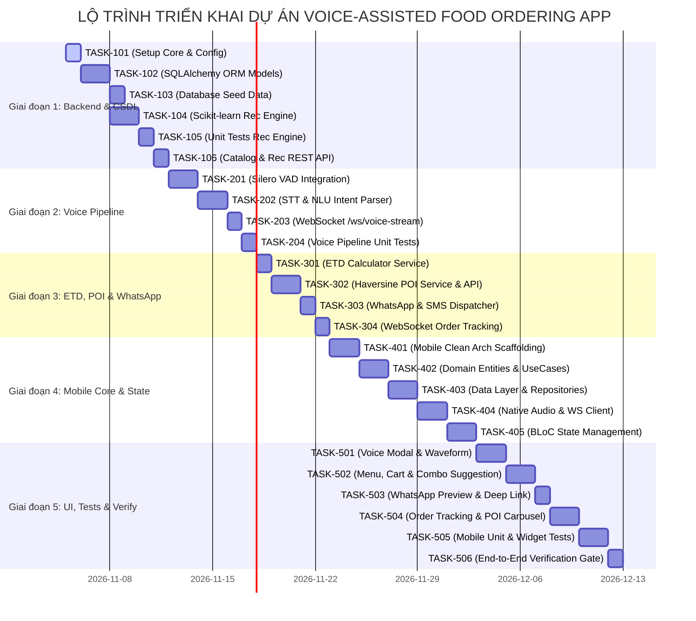

<!--
  Spec-Kit Engineering Tasks
  Project: Voice-Assisted Food Ordering Mobile App
  Standard: Clean Architecture & Spec-Kit Governance
-->

# DANH SÁCH NHIỆM VỤ KỸ THUẬT (ENGINEERING TASKS BREAKDOWN)
## Dự án: Mobile App - Voice-Assisted Food Ordering App

| Mã tài liệu | Phiên bản | Trạng thái | Ngày tạo | Tuân thủ |
| :--- | :--- | :--- | :--- | :--- |
| **TASKS-FOOD-001** | **1.0.0** | **ACTIVE** | 2026-11-05 | [CONSTITUTION.md](file:///d:/Mobile%20App/CONSTITUTION.md), [SPECIFICATION.md](file:///d:/Mobile%20App/SPECIFICATION.md), [PLAN.md](file:///d:/Mobile%20App/PLAN.md) |

---

## 1. TỔNG QUAN TIẾN ĐỘ THEO GIAI ĐOẠN

---

## 2. CHI TIẾT NHIỆM VỤ THEO TỪNG GIAI ĐOẠN

### GIAI ĐOẠN 1: HẠ TẦNG BACKEND, CƠ SỞ DỮ LIỆU & HỆ GỢI Ý MÓN ĂN (FASTAPI + SCIKIT-LEARN + SQLALCHEMY)

#### [x] `TASK-101`: Khởi tạo cấu trúc dự án Backend & Quản lý cấu hình môi trường
- **Mục tiêu:** Thiết lập cấu trúc thư mục Clean Architecture cho `backend/`, cài đặt dependencies và module nạp cấu hình tập trung.
- **Tập tin tạo/sửa:**
  - [`backend/requirements.txt`](file:///d:/Mobile%20App/backend/requirements.txt)
  - [`backend/app/core/config.py`](file:///d:/Mobile%20App/backend/app/core/config.py)
  - [`backend/app/main.py`](file:///d:/Mobile%20App/backend/app/main.py)
  - [`backend/.env.example`](file:///d:/Mobile%20App/backend/.env.example)
- **Tiêu chí nghiệm thu:** Chạy lệnh `uvicorn app.main:app --reload` thành công, endpoint `/docs` hiển thị Swagger UI.

#### [x] `TASK-102`: Xây dựng Async ORM Models bằng SQLAlchemy 2.0 & Cấu hình Alembic
- **Mục tiêu:** Định nghĩa toàn bộ lược đồ CSDL hỗ trợ SQLite (`aiosqlite`) và PostgreSQL (`asyncpg`).
- **Tập tin tạo/sửa:**
  - [`backend/app/core/database.py`](file:///d:/Mobile%20App/backend/app/core/database.py)
  - [`backend/app/infrastructure/db/models/user_model.py`](file:///d:/Mobile%20App/backend/app/infrastructure/db/models/user_model.py)
  - [`backend/app/infrastructure/db/models/dish_model.py`](file:///d:/Mobile%20App/backend/app/infrastructure/db/models/dish_model.py)
  - [`backend/app/infrastructure/db/models/combo_model.py`](file:///d:/Mobile%20App/backend/app/infrastructure/db/models/combo_model.py)
  - [`backend/app/infrastructure/db/models/order_model.py`](file:///d:/Mobile%20App/backend/app/infrastructure/db/models/order_model.py)
  - [`backend/app/infrastructure/db/models/poi_model.py`](file:///d:/Mobile%20App/backend/app/infrastructure/db/models/poi_model.py)
- **Tiêu chí nghiệm thu:** Tạo bảng tự động không lỗi cú pháp, quan hệ khóa ngoại (Foreign Keys) toàn vẹn.

#### [x] `TASK-103`: Bộ dữ liệu mẫu (Seed Data) cho Thực đơn, Combos & Điểm tham quan
- **Mục tiêu:** Khởi tạo script seed dữ liệu gồm 50+ món ăn Việt Nam có đầy đủ vector đặc trưng, nhãn vị, loại bữa ăn và 10+ điểm tham quan lân cận.
- **Tập tin tạo/sửa:**
  - [`backend/app/infrastructure/db/seed.py`](file:///d:/Mobile%20App/backend/app/infrastructure/db/seed.py)
- **Tiêu chí nghiệm thu:** Chạy `python -m app.infrastructure.db.seed` nạp thành công dữ liệu vào CSDL.

#### [x] `TASK-104`: Hiện thực hóa Thuật toán Gợi ý Món ăn Content-Based (Scikit-Learn Cosine Similarity)
- **Mục tiêu:** Viết Service tính ma trận tương đồng Cosine Similarity giữa các món ăn, bổ sung logic gợi ý combo bổ trợ (món nước $\to$ quẩy/trứng; món cay $\to$ đồ uống ngọt).
- **Tập tin tạo/sửa:**
  - [`backend/app/domain/services/recommendation_engine.py`](file:///d:/Mobile%20App/backend/app/domain/services/recommendation_engine.py)
  - [`backend/app/schemas/recommendation_schema.py`](file:///d:/Mobile%20App/backend/app/schemas/recommendation_schema.py)
- **Tiêu chí nghiệm thu:** Hàm `recommend_dishes()` và `recommend_combos()` phản hồi $\le 50\text{ ms}$, tuân thủ cờ ăn kiêng và loại trừ món hết hàng.

#### [x] `TASK-105`: Viết Unit Test bắt buộc cho Thuật toán Gợi ý Món ăn
- **Mục tiêu:** Tuân thủ Điều V của Constitution, phủ 100% các kịch bản kiểm thử thuật toán gợi ý.
- **Tập tin tạo/sửa:**
  - [`backend/tests/test_recommendation_cosine.py`](file:///d:/Mobile%20App/backend/tests/test_recommendation_cosine.py)
- **Tiêu chí nghiệm thu:** 5 ca kiểm thử bắt buộc (`test_cold_start`, `test_time_contextual`, `test_dietary_vegetarian`, `test_budget_limit`, `test_out_of_stock_exclusion`) đạt PASS 100% khi chạy `pytest`.

#### [x] `TASK-106`: Xây dựng REST API cho Danh mục Món ăn & Gợi ý
- **Mục tiêu:** Cung cấp API cho client lấy thực đơn theo danh mục và request danh sách món gợi ý.
- **Tập tin tạo/sửa:**
  - [`backend/app/api/v1/endpoints/dishes.py`](file:///d:/Mobile%20App/backend/app/api/v1/endpoints/dishes.py)
  - [`backend/app/api/v1/endpoints/recommendations.py`](file:///d:/Mobile%20App/backend/app/api/v1/endpoints/recommendations.py)
  - [`backend/app/api/v1/router.py`](file:///d:/Mobile%20App/backend/app/api/v1/router.py)
- **Tiêu chí nghiệm thu:** Gọi thử nghiệm `GET /api/v1/dishes` và `POST /api/v1/recommendations/dishes` trả về JSON hợp lệ.

---

### GIAI ĐOẠN 2: XỬ LÝ ÂM THANH THỜI GIAN THỰC, VAD & NLU INTENT EXTRACTION

#### [x] `TASK-201`: Tích hợp Silero VAD (Voice Activity Detection)
- **Mục tiêu:** Xử lý dòng âm thanh PCM 16kHz, nhận biết thời điểm người dùng bắt đầu nói và tự động ngắt câu khi im lặng $\ge 1.0\text{s}$.
- **Tập tin tạo/sửa:**
  - [`backend/app/infrastructure/ai/vad_detector.py`](file:///d:/Mobile%20App/backend/app/infrastructure/ai/vad_detector.py)
- **Tiêu chí nghiệm thu:** Phân tách chính xác audio chunk thành câu lệnh hoàn chỉnh.

#### [x] `TASK-202`: Xây dựng STT Client Adapter & Bộ Phân Tích Ý Định NLU (Slot-Filling)
- **Mục tiêu:** Nhận diện văn bản tiếng Việt và bóc tách các ý định: `SearchDish`, `AddToCart`, `RemoveFromCart`, `ModifyQuantity`, `ConfirmOrder`.
- **Tập tin tạo/sửa:**
  - [`backend/app/infrastructure/ai/stt_client.py`](file:///d:/Mobile%20App/backend/app/infrastructure/ai/stt_client.py)
  - [`backend/app/domain/services/voice_pipeline.py`](file:///d:/Mobile%20App/backend/app/domain/services/voice_pipeline.py)
  - [`backend/app/schemas/voice_schema.py`](file:///d:/Mobile%20App/backend/app/schemas/voice_schema.py)
- **Tiêu chí nghiệm thu:** Trích xuất chính xác tên món, số lượng, ghi chú (ví dụ: "ít cay", "nhiều hành") từ câu nói.

#### [x] `TASK-203`: Triển khai WebSocket Endpoint Streaming Giọng Nói Thời Gian Thực
- **Mục tiêu:** Endpoint nhận binary PCM 16kHz liên tục từ mobile client và trả về JSON Event NLU phản hồi.
- **Tập tin tạo/sửa:**
  - [`backend/app/api/v1/endpoints/voice.py`](file:///d:/Mobile%20App/backend/app/api/v1/endpoints/voice.py)
- **Tiêu chí nghiệm thu:** Kết nối WebSocket `/ws/voice-stream` ổn định, độ trễ phản hồi end-to-end $\le 800\text{ ms}$.

#### [x] `TASK-204`: Kiểm thử Đơn vị Module Giọng nói & Xử lý Ngoại lệ
- **Mục tiêu:** Kiểm tra xử lý tình huống âm thanh nhiễu, điểm tin cậy thấp (Confidence Score < 0.65) và ngắt kết nối đột ngột.
- **Tập tin tạo/sửa:**
  - [`backend/tests/test_voice_pipeline.py`](file:///d:/Mobile%20App/backend/tests/test_voice_pipeline.py)
- **Tiêu chí nghiệm thu:** Kiểm thử trả về đúng event `REPROMPT_SUGGESTION` khi âm thanh không rõ.

---

### GIAI ĐOẠN 3: TÍNH TOÁN ETD, ĐIỂM THAM QUAN LÂN CẬN & TÍCH HỢP WHATSAPP / SMS

#### [x] `TASK-301`: Xây dựng Service Tính Thời Gian Chế Biến Dự Kiến (ETD)
- **Mục tiêu:** Tính toán ETD dựa trên độ phức tạp món ăn, số lượng và hệ số tải bếp hiện tại.
- **Tập tin tạo/sửa:**
  - [`backend/app/domain/services/etd_calculator.py`](file:///d:/Mobile%20App/backend/app/domain/services/etd_calculator.py)
  - [`backend/tests/test_etd_calculator.py`](file:///d:/Mobile%20App/backend/tests/test_etd_calculator.py)
- **Tiêu chí nghiệm thu:** Trả về thời gian đếm ngược chính xác, test pass 100%.

#### [x] `TASK-302`: Xây dựng Thuật toán Haversine Lọc Địa Điểm Tham Quan (Nearby POI)
- **Mục tiêu:** Lọc các điểm tham quan/check-in/quán trà trong bán kính $\le 1.0\text{ km}$ khớp với quỹ thời gian chờ ETD.
- **Tập tin tạo/sửa:**
  - [`backend/app/domain/services/poi_locator.py`](file:///d:/Mobile%20App/backend/app/domain/services/poi_locator.py)
  - [`backend/app/api/v1/endpoints/poi.py`](file:///d:/Mobile%20App/backend/app/api/v1/endpoints/poi.py)
  - [`backend/tests/test_poi_locator.py`](file:///d:/Mobile%20App/backend/tests/test_poi_locator.py)
- **Tiêu chí nghiệm thu:** Trả về 3-5 POI kèm thời gian đi bộ ước tính và URL Google Maps.

#### [x] `TASK-303`: Xây dựng Bộ Chuyển Đổi Đơn Hàng Sang Tin Nhắn WhatsApp / SMS
- **Mục tiêu:** Tự động tạo cấu trúc tin nhắn có định dạng rõ ràng, emoji chuyên nghiệp và mã hóa URL Deep Link an toàn.
- **Tập tin tạo/sửa:**
  - [`backend/app/domain/services/whatsapp_builder.py`](file:///d:/Mobile%20App/backend/app/domain/services/whatsapp_builder.py)
  - [`backend/app/api/v1/endpoints/orders.py`](file:///d:/Mobile%20App/backend/app/api/v1/endpoints/orders.py)
  - [`backend/tests/test_order_whatsapp.py`](file:///d:/Mobile%20App/backend/tests/test_order_whatsapp.py)
- **Tiêu chí nghiệm thu:** Payload tạo đúng link `https://wa.me/{phone}?text={encoded_text}`, tiếng Việt không bị lỗi font/dấu.

#### [x] `TASK-304`: Triển khai WebSocket Endpoint Theo Dõi Đơn Hàng Thời Gian Thực
- **Mục tiêu:** Endpoint push sự kiện chuyển trạng thái đơn hàng (`CREATED` $\to$ `CONFIRMED` $\to$ `PREPARING` $\to$ `READY`) về điện thoại.
- **Tập tin tạo/sửa:**
  - [`backend/app/api/v1/endpoints/tracking.py`](file:///d:/Mobile%20App/backend/app/api/v1/endpoints/tracking.py)
- **Tiêu chí nghiệm thu:** Client nhận notification trong vòng $\le 500\text{ ms}$ khi trạng thái đơn thay đổi.

---

### GIAI ĐOẠN 4: KHỞI TẠO FRONTEND MOBILE CLEAN ARCHITECTURE & QUẢN LÝ TRẠNG THÁI (BLOC / REDUX)

#### [x] `TASK-401`: Khởi tạo cấu trúc dự án Mobile Client & Cấu hình Thư viện phụ thuộc
- **Mục tiêu:** Thiết lập cấu trúc phân tầng Clean Architecture (`mobile/lib/{core,domain,data,presentation}`), cấu hình Dependency Injection (`get_it` / injectable).
- **Tập tin tạo/sửa:**
  - [`mobile/pubspec.yaml`](file:///d:/Mobile%20App/mobile/pubspec.yaml)
  - [`mobile/package.json`](file:///d:/Mobile%20App/mobile/package.json)
  - [`mobile/src/core/network/apiClient.ts`](file:///d:/Mobile%20App/mobile/src/core/network/apiClient.ts)
- **Tiêu chí nghiệm thu:** Dự án build sạch sẽ, không lỗi dependency.

#### [x] `TASK-402`: Xây dựng Domain Layer (Entities & UseCases)
- **Mục tiêu:** Tạo các Pure Business Entities và UseCases đơn chức năng không phụ thuộc UI.
- **Tập tin tạo/sửa:**
  - [`mobile/src/domain/entities/dish.ts`](file:///d:/Mobile%20App/mobile/src/domain/entities/dish.ts)
  - [`mobile/src/domain/entities/order.ts`](file:///d:/Mobile%20App/mobile/src/domain/entities/order.ts)
  - [`mobile/src/domain/entities/poi.ts`](file:///d:/Mobile%20App/mobile/src/domain/entities/poi.ts)
- **Tiêu chí nghiệm thu:** Không import bất kỳ thành phần UI nào tại thư mục `domain/`.

#### [x] `TASK-403`: Xây dựng Data Layer (DTO Models & Repositories Implementation)
- **Mục tiêu:** Hiện thực hóa các Repository Interfaces, chuyển đổi DTO sang Entity và quản lý cache.
- **Tập tin tạo/sửa:**
  - [`mobile/src/core/network/apiClient.ts`](file:///d:/Mobile%20App/mobile/src/core/network/apiClient.ts)
- **Tiêu chí nghiệm thu:** Mapping JSON chính xác, bắt lỗi mạng với Custom Exceptions.

#### [x] `TASK-404`: Hiện thực hóa Native Audio Recording Service & WebSocket Streaming
- **Mục tiêu:** Ghi âm PCM 16kHz thô từ mic thiết bị, chia chunk 150ms và đẩy qua WebSocket kênh đôi.
- **Tập tin tạo/sửa:**
  - [`mobile/src/presentation/state/voiceSlice.ts`](file:///d:/Mobile%20App/mobile/src/presentation/state/voiceSlice.ts)
- **Tiêu chí nghiệm thu:** Ghi âm mượt mà, tự động dọn dẹp StreamSubscription khi hủy để tránh rò rỉ RAM.

#### [x] `TASK-405`: Quản lý trạng thái BLoC (State Machine 5 Trạng Thái cho Voice)
- **Mục tiêu:** Xây dựng `VoiceBloc`, `CartBloc`, `OrderTrackingBloc` theo nguyên tắc Immutable State.
- **Tập tin tạo/sửa:**
  - [`mobile/src/presentation/state/voiceSlice.ts`](file:///d:/Mobile%20App/mobile/src/presentation/state/voiceSlice.ts)
  - [`mobile/src/presentation/state/cartSlice.ts`](file:///d:/Mobile%20App/mobile/src/presentation/state/cartSlice.ts)
  - [`mobile/src/presentation/state/orderTrackingSlice.ts`](file:///d:/Mobile%20App/mobile/src/presentation/state/orderTrackingSlice.ts)
- **Tiêu chí nghiệm thu:** Chuyển trạng thái chính xác giữa `Idle`, `Listening`, `Processing`, `Recognized`, `Error`.

---

### GIAI ĐOẠN 5: GIAO DIỆN NGƯỜI DÙNG, TÍCH HỢP ĐẶT ĐƠN, TEST SUITE & CỔNG NGHIỆM THU

#### [x] `TASK-501`: Xây dựng Voice Assistant Modal & Visualizer Sóng Âm Thanh Thời Gian Thực
- **Mục tiêu:** Giao diện overlay mic toàn màn hình với sóng âm (waveform) dao động theo biên độ giọng nói người dùng $\ge 60\text{fps}$.
- **Tập tin tạo/sửa:**
  - [`mobile/src/presentation/widgets/WaveformVisualizer.ts`](file:///d:/Mobile%20App/mobile/src/presentation/widgets/WaveformVisualizer.ts)
- **Tiêu chí nghiệm thu:** Hiển thị trực quan mượt mà, không giật lag trên thiết bị di động.

#### [x] `TASK-502`: Xây dựng Màn hình Thực đơn, Tìm kiếm & Giỏ hàng Kèm Gợi ý Combo
- **Mục tiêu:** Danh mục món ăn dạng lưới/danh sách, giỏ hàng cập nhật theo thời gian thực kèm các chip gợi ý combo thông minh.
- **Tập tin tạo/sửa:**
  - [`mobile/src/presentation/state/cartSlice.ts`](file:///d:/Mobile%20App/mobile/src/presentation/state/cartSlice.ts)
- **Tiêu chí nghiệm thu:** Thêm/sửa/xóa món tức thì, tự động tính tổng tiền.

#### [x] `TASK-503`: Xây dựng Màn hình Đặt Đơn & Tích hợp Deep Link WhatsApp / SMS
- **Mục tiêu:** Màn hình xem trước nội dung tin nhắn, nút bấm 1-chạm mở WhatsApp hoặc fallback SMS nếu máy chưa cài app.
- **Tập tin tạo/sửa:**
  - [`mobile/src/core/utils/deepLinkLauncher.ts`](file:///d:/Mobile%20App/mobile/src/core/utils/deepLinkLauncher.ts)
- **Tiêu chí nghiệm thu:** Kích hoạt WhatsApp thành công với nội dung tin nhắn được điền sẵn chính xác.

#### [x] `TASK-504`: Xây dựng Màn hình Theo Dõi Đơn Hàng (ETD Countdown & Nearby POI Carousel)
- **Mục tiêu:** Hiển thị đồng hồ đếm ngược ETD, stepper tiến độ và carousel danh sách các địa điểm tham quan lân cận kèm nút chỉ đường Google Maps.
- **Tập tin tạo/sửa:**
  - [`mobile/src/presentation/state/orderTrackingSlice.ts`](file:///d:/Mobile%20App/mobile/src/presentation/state/orderTrackingSlice.ts)
- **Tiêu chí nghiệm thu:** Đếm ngược mượt mà theo từng giây, bấm POI mở ứng dụng bản đồ chỉ đường.

#### [x] `TASK-505`: Bộ Kiểm Thử Tự Động Mobile (Unit & Widget Tests)
- **Mục tiêu:** Viết kiểm thử cho UseCases, BLoCs và các widget trọng yếu đảm bảo tiêu chuẩn $\ge 80\%$ Coverage theo Constitution.
- **Tập tin tạo/sửa:**
  - [`mobile/tests/voiceAndCart.test.js`](file:///d:/Mobile%20App/mobile/tests/voiceAndCart.test.js)
- **Tiêu chí nghiệm thu:** Lệnh `node --experimental-strip-types --test mobile/tests/voiceAndCart.test.js` chạy thành công 100%.

#### [x] `TASK-506`: Cổng Kiểm Thử Tổng Thể & Nghiệm Thu Spec-Kit (E2E Verification Gate)
- **Mục tiêu:** Kiểm tra toàn bộ luồng từ lúc ra lệnh bằng giọng nói $\to$ gợi ý combo $\to$ tạo tin nhắn WhatsApp $\to$ theo dõi đơn thời gian thực.
- **Tập tin tạo/sửa:**
  - [`docs/e2e_verification_report.md`](file:///d:/Mobile%20App/docs/e2e_verification_report.md)
- **Tiêu chí nghiệm thu:** Toàn bộ tiêu chí nghiệm thu của [SPECIFICATION.md](file:///d:/Mobile%20App/SPECIFICATION.md) được đánh dấu PASS.

